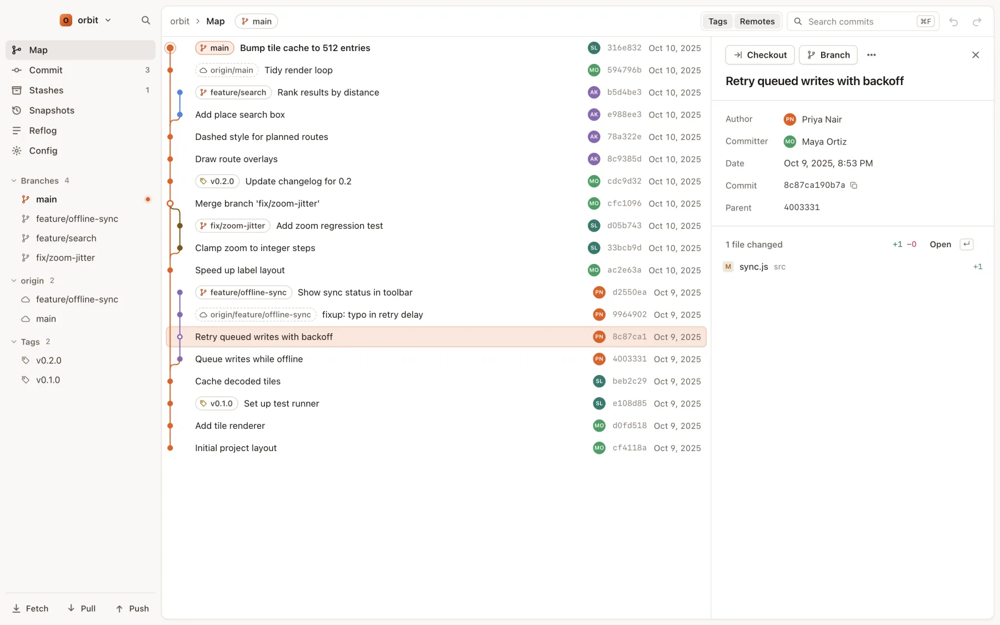

# Since

A fast, keyboard-first Git client for macOS. The main screen is a live commit graph you operate on
directly, with undo and redo for every change to your repository. Built to supervise and land agent work.

<picture>
  <source media="(prefers-color-scheme: dark)" srcset="apps/web/src/assets/features/map-dark.webp">
  
</picture>

- A live commit graph you work on directly: branch, rebase, merge, stash and clean up from the graph.
- Undo and redo for every ref change, stash and config edit.
- Keyboard-first, with a ⌘K command palette for every action.
- Light and dark themes.
- Uses the `git` already on your Mac. No accounts, no telemetry; the network calls it makes are
  listed in [docs/security.md](docs/security.md).

## Install

Download the latest build for Apple silicon or Intel from [gitsince.com/download](https://gitsince.com/download).
Since needs macOS 12 or later. You can also build it from source (below).

## Development

You need macOS, Node.js 24 (see `.nvmrc`), Git and pnpm. pnpm is required; npm, yarn and bun installs
are blocked.

    corepack enable      # once: provides the pnpm version pinned in package.json
    pnpm install
    pnpm desktop [-- path/to/repo]
    pnpm test            # unit tests for every package
    pnpm web             # website dev server
    pnpm web:build       # static build into apps/web/dist, plus an internal link check
    pnpm dist            # unsigned macOS DMGs into apps/desktop/dist

| Path | What |
|---|---|
| `apps/desktop` | The Electron app ([README](apps/desktop/README.md)) |
| `apps/web` | The website (Astro, static) |
| `packages/tokens` | Colour tokens for both themes, shared by the site (and mirrored in the desktop app) |
| `docs` | Security and network audit, performance notes, [building and releasing](docs/releasing.md) |

The end-to-end tests (Playwright + Electron) open real Since windows. Run one spec at a time from
`apps/desktop`:

    pnpm exec playwright test -c e2e undo.spec.js --workers=1

## Contributing

See [CONTRIBUTING.md](CONTRIBUTING.md). To report a vulnerability, see [SECURITY.md](SECURITY.md).

## Licence

Copyright (C) 2026 0xa3k5 and Since contributors

Since is free software: you can redistribute it and/or modify it under the terms of the GNU General
Public License as published by the Free Software Foundation, either version 3 of the License, or (at
your option) any later version. It is distributed in the hope that it will be useful, but WITHOUT ANY
WARRANTY; without even the implied warranty of MERCHANTABILITY or FITNESS FOR A PARTICULAR PURPOSE.
See [LICENSE](LICENSE) for the full text (`GPL-3.0-or-later`).

## Trademark

The licence covers the code only. It doesn't grant any right to use the Since name or logo: if you
distribute a modified version, give it a different name and icon.

Git™ is a trademark of Software Freedom Conservancy. Since is not affiliated with or endorsed by the
Git project.
